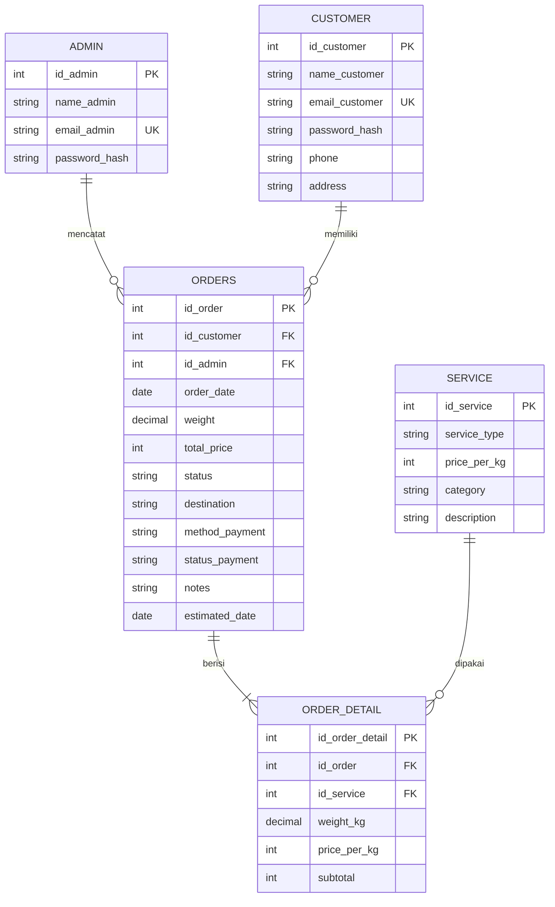

<h1 align="center">LaundryKita</h1>

<p align="center">
Aplikasi desktop untuk mencatat pesanan laundry, mengelola pelanggan dan layanan, serta memantau status cucian.
</p>

<p align="center">
  
  
  
  
</p>

LaundryKita adalah aplikasi desktop Java Swing dengan dua peran. Admin mencatat pesanan, mengelola data pelanggan dan layanan, lalu memperbarui status cucian. Pelanggan melihat status pesanan, rincian tagihan, dan riwayat cucian dari akun masing-masing.

## Fitur

### Admin

- Ringkasan menampilkan jumlah pesanan menunggu, pesanan yang sedang diproses, total pesanan, jumlah pelanggan, dan lima pesanan terbaru.
- Halaman Pesanan mendukung pencarian nama pelanggan atau kode pesanan, filter status, pengurutan berat dan total, detail pesanan, perubahan status, dan penghapusan.
- Form Pesanan Baru memilih pelanggan, mengisi alamat dari profil pelanggan, mencatat berat per layanan, menghitung subtotal dan total secara langsung, memilih tanggal estimasi lewat kalender, serta menyimpan status dan catatan.
- Halaman Pelanggan menyediakan tambah, ubah, hapus, pencarian nama atau email atau telepon, dan jumlah pesanan tiap pelanggan.
- Halaman Layanan mengelola nama layanan, harga per kg, kategori, deskripsi, dan jumlah pemakaian.

### Pelanggan

- Beranda menampilkan pesanan aktif, estimasi selesai, status pembayaran, total tagihan, jumlah pesanan, jumlah pesanan selesai, total belanja, dan lima pesanan terbaru.
- Halaman Pesanan Saya mendukung pencarian kode pesanan, filter status, dan detail rincian layanan.
- Halaman Profil mengubah nama, email, telepon, dan alamat, serta mengganti password dengan minimal enam karakter.

### Masuk dan hak akses

Satu halaman login dipakai untuk admin dan pelanggan. Aplikasi mencari email di tabel `admin` lebih dulu, lalu di tabel `customer`. Peran dari akun yang cocok menentukan panel yang dibuka.

Akun pelanggan dibuat oleh admin. Tidak ada pendaftaran mandiri dari halaman login.

## Teknologi

| Bagian | Teknologi |
| --- | --- |
| Bahasa | Java 17 atau lebih baru |
| Antarmuka | Java Swing, FlatLaf 3.8 |
| Database | MySQL 8.x, MySQL Connector/J 8.4.0 |
| Password | ***** |
| Pemilih tanggal | JCalendar 1.4 |
| Build | Proyek IntelliJ IDEA, tanpa Maven atau Gradle |

Seluruh dependensi berada di `app/lib` dan sudah terdaftar di `.idea/libraries/lib.xml`. `protobuf-java-3.25.1.jar` disertakan sebagai pendukung Connector/J.

## Struktur proyek

```text
src/main/java/laundrykita/
├── Main.java
├── config/     konfigurasi koneksi JDBC
├── dao/        akses data dan query SQL
├── service/    aturan bisnis, autentikasi, dan transaksi
├── model/      entitas, enum status, dan sesi pengguna
├── gui/
│   ├── admin/      panel ringkasan, pesanan, pelanggan, layanan
│   ├── customer/   panel beranda, pesanan, profil
│   ├── login/      halaman masuk
│   └── ...         tema, komponen, ikon, dan format tampilan
├── view/       frame utama dan perpindahan halaman
└── util/       hash password bcrypt
```

## Database

Skema terdiri dari lima tabel: `admin`, `customer`, `service`, `orders`, dan `order_detail`.



Nilai yang dipakai di kolom status:

| Kolom | Nilai |
| --- | --- |
| `orders.status` | Menunggu, Diproses, Dicuci, Disetrika, Selesai |
| `orders.method_payment` | Tunai, Transfer, QRIS |
| `orders.status_payment` | Belum Bayar, Lunas |

Kode pesanan dibentuk dari `id_order` dengan format `#LK001`, `#LK002`, dan seterusnya. Setiap baris `order_detail` menyimpan harga per kg dan subtotal saat pesanan dibuat, sehingga perubahan harga layanan tidak mengubah tagihan pesanan lama.

## Menjalankan aplikasi

### 1. Siapkan database

Pastikan MySQL berjalan di port `3306`, lalu buat database dan impor file SQL.

```bash
mysql -u root -p -e "CREATE DATABASE IF NOT EXISTS laundrykita CHARACTER SET utf8mb4 COLLATE utf8mb4_general_ci;"
mysql -u root -p laundrykita < laundrykita.sql
```

Di XAMPP, database `laundrykita` bisa dibuat lewat phpMyAdmin, lalu file `laundrykita.sql` diimpor dari tab Import.

### 2. Atur koneksi

Tanpa konfigurasi tambahan, aplikasi memakai:

```text
URL      : jdbc:mysql://localhost:3306/laundrykita?useUnicode=true&characterEncoding=UTF-8
User     : root
Password : kosong
```

Untuk pengaturan lain, buat file `database.properties` di direktori kerja aplikasi:

```properties
db.url=jdbc:mysql://localhost:3306/laundrykita?useUnicode=true&characterEncoding=UTF-8
db.user=root
db.password=
```

Nilai dibaca dengan urutan: system property, environment variable, `database.properties`, lalu nilai default.

| Pengaturan | System property | Environment variable |
| --- | --- | --- |
| URL | `laundrykita.db.url` | `LAUNDRYKITA_DB_URL` |
| User | `laundrykita.db.user` | `LAUNDRYKITA_DB_USER` |
| Password | `laundrykita.db.password` | `LAUNDRYKITA_DB_PASSWORD` |

### 3. Jalankan

Lewat IntelliJ IDEA, buka folder proyek, pilih JDK 17 atau lebih baru, lalu jalankan main class `laundrykita.Main`. Library `lib` sudah menunjuk ke jar di `app/lib`.

Lewat terminal Git Bash di Windows:

```bash
mkdir -p out/classes
javac -encoding UTF-8 -cp "app/lib/*" -d out/classes $(find src/main/java -name '*.java')
java -cp "out/classes;app/lib/*" laundrykita.Main
```

Jalankan perintah dari root proyek agar `database.properties` ditemukan. Di Linux atau macOS, ganti pemisah classpath `;` menjadi `:`.

### 4. Masuk

| Akun | Email | Password | Akses |
| --- | --- | --- | --- |
| Admin | `admin@laundrykita.com` | `admin123` | Panel admin |
| Kasir | `kasir@laundrykita.com` | `admin123` | Panel admin |
| Pelanggan | `salwa@email.com` | `customer123` | Panel pelanggan |

Akun di atas berasal dari data contoh di `laundrykita.sql`. Ganti password sebelum aplikasi dipakai di luar demonstrasi.

## Catatan teknis

- Password disimpan sebagai hash bcrypt dengan cost 10. Hash `$2y$` dari data contoh dinormalisasi ke `$2a$` saat diverifikasi oleh jBCrypt.
- Pesanan dan rincian layanannya disimpan dalam satu transaksi. Total berat dan total harga dihitung ulang di `OrderService`, bukan hanya mengandalkan nilai dari form.
- Tampilan memakai FlatLaf dengan tema krem dan aksen terakota. Ikon digambar di `UiIcons`, tanpa file gambar eksternal.
- Tanggal estimasi memakai JCalendar dan tidak bisa diketik manual.
- Repositori ini belum memiliki build otomatis atau pengujian otomatis.
